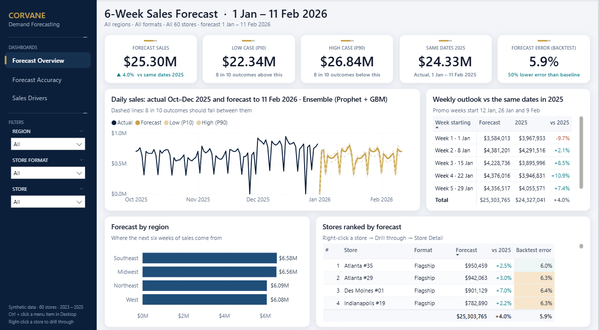
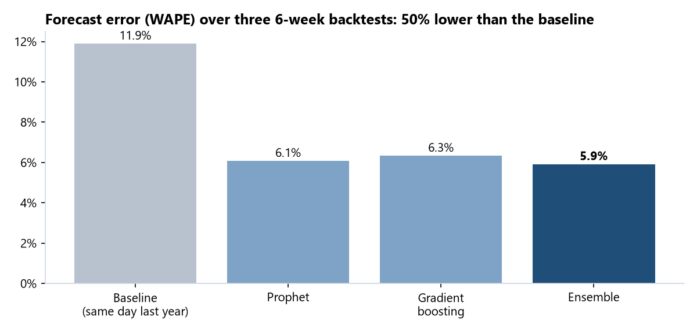
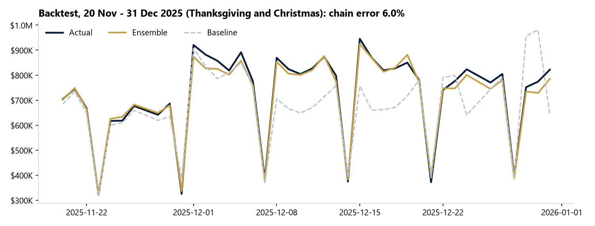
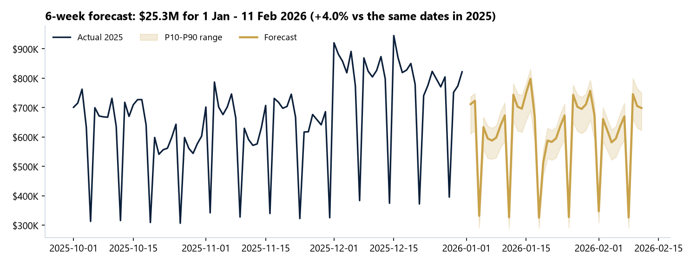
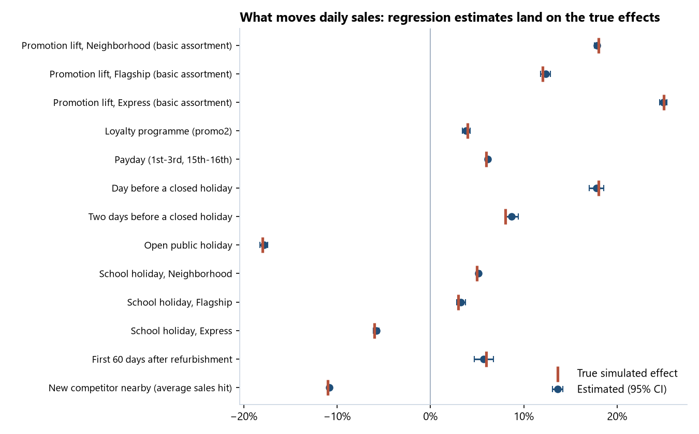
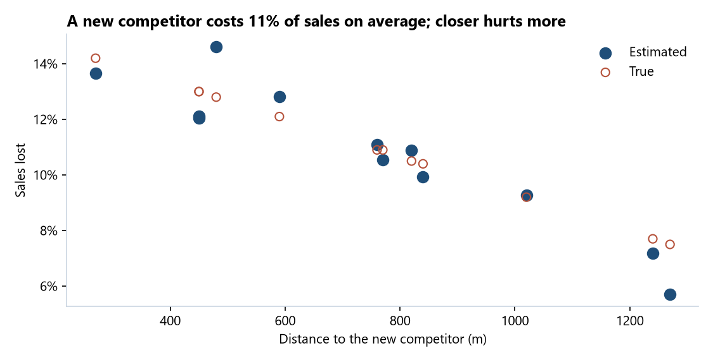
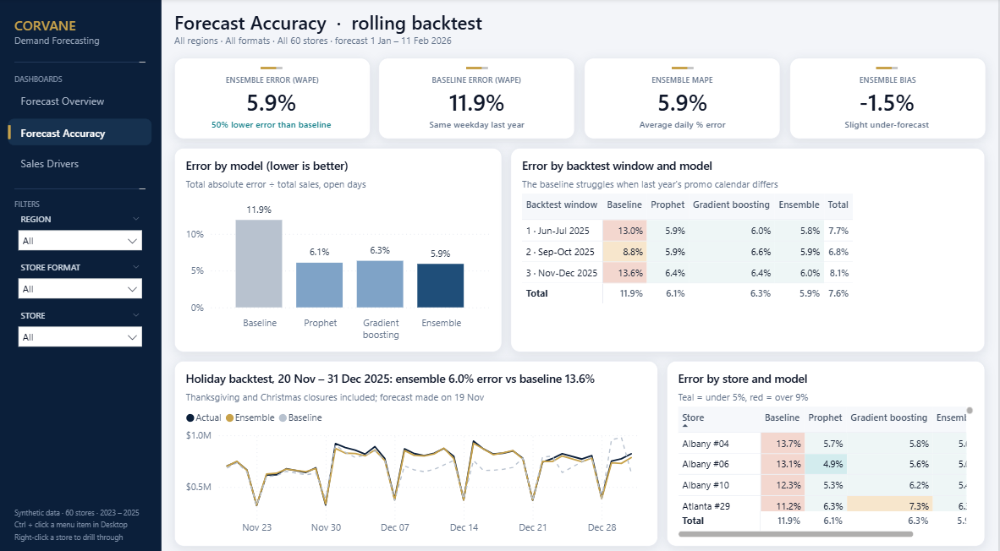
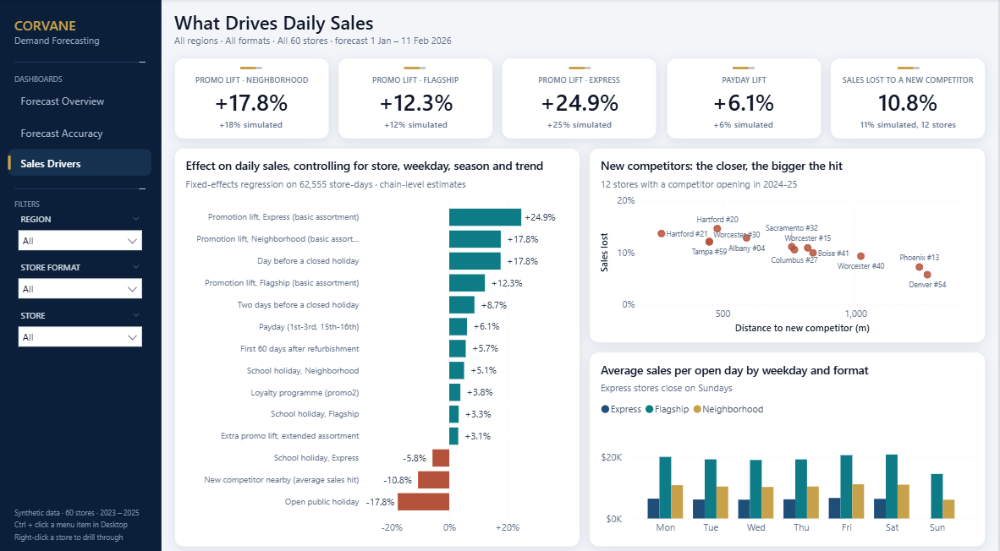
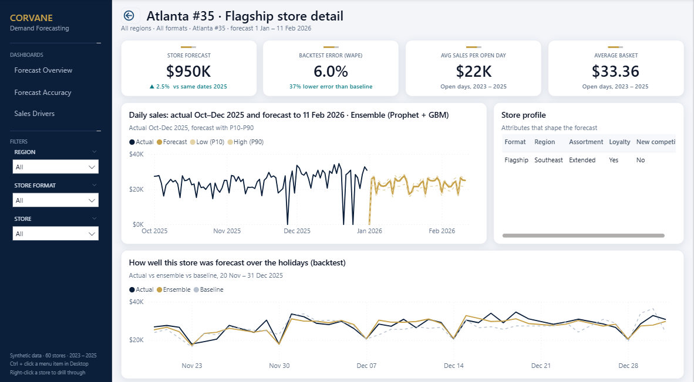

# Retail Demand Forecasting: 60-Store Daily Sales Forecast

**Python data generation & cleaning → feature engineering → Prophet + gradient boosting + ensemble → rolling backtest → driver analysis → Excel forecast workbook → Power BI dashboard**

Corvane Drugstores (fictional) runs 60 stores in three formats across four US regions. Planning needs a **daily sales forecast for every store for the next six weeks** (1 Jan – 11 Feb 2026) to set staffing, stock and promotion budgets, and wants to know **what actually drives sales**: promotions, holidays, paydays, school breaks or new competitors.

**Live summary page:** _see below once deployed_



> **About the data.** The dataset is **synthetic**. I wrote a generator ([`scripts/generate_data.py`](scripts/generate_data.py)) that simulates 3 years of daily sales for 60 stores with documented effects (growth, seasonality, weekday and payday patterns, promotions, holidays, school breaks, a loyalty programme, new competitors, refurbishment closures, noise) and realistic mess in the raw export. Because the true effects are known ([`data_raw/true_effects.json`](data_raw/true_effects.json)), the driver analysis can be **checked against the truth**, which a real dataset can't offer.

## Key results

| | Result | So what |
|---|---|---|
| 1 | **The ensemble (Prophet + gradient boosting) has 5.9% error (WAPE)** across three 6-week backtests, against **11.9% for "same weekday last year"**: a **50% reduction**. | Daily store forecasts accurate enough to staff and order from. |
| 2 | It beats the baseline in **all 60 stores** (store-level error 5.0% to 6.8%) and in every backtest window, including **Thanksgiving to Christmas (6.0%)**. | No store needs a manual override. |
| 3 | The noise built into the data alone causes about 5.6% average daily error, so the model is **close to the best achievable**. | Further gains would come from better inputs, not a fancier model. |
| 4 | **Forecast for 1 Jan – 11 Feb 2026: $25.30M** (P10 $22.34M, P90 $26.84M), **+4.0% on the same dates in 2025**, in line with underlying growth. | Budget and buffer stock against the P10–P90 range. |
| 5 | **Promotions lift sales 12% (Flagship), 18% (Neighborhood) and 25% (Express)**, +3 points with the extended assortment. A naive promo-vs-no-promo comparison says +23% for everyone. | Target promotion spend at Express and Neighborhood stores. |
| 6 | **Calendar effects:** payday +6%, the day before a closed holiday +18% (two days before +9%), open public holidays −18%, school breaks +5% Neighborhood / +3% Flagship / −6% Express. | Plan staff rotas and deliveries around them. |
| 7 | **A new competitor nearby costs 11% of sales on average**, from 14% when it opens next door to 6% at 1.3 km. | Use distance to price the risk of competitor openings. |
| 8 | Week 1 of 2026 is forecast **below** the same week of 2025 because 2–7 Jan 2025 had four promotion days and the 2026 plan has none until 12 Jan. | The forecast follows the plan, not last year's calendar. |

Every estimate in rows 5–7 sits within about a point of the true simulated value (table below).

## Forecasting approach

| Model | How | Backtest WAPE |
|---|---|---:|
| Baseline | Sales on the same weekday 52 weeks earlier | 11.9% |
| Prophet | One model per store on log sales: yearly + weekly seasonality, regressors for promo, school holiday, payday, loyalty programme, competitor (phased in), pre-holiday, open holiday, post-refurbishment | 6.1% |
| Gradient boosting | One global `HistGradientBoostingRegressor` on log sales: store attributes, calendar, promo, holidays, competitor, and levels lagged 42+ days (so nothing from the forecast window leaks in) | 6.3% |
| **Ensemble** | **Average of Prophet and gradient boosting (selected)** | **5.9%** |

* **Validation:** rolling-origin backtest, three 42-day windows (from 31 May, 31 Aug and 19 Nov 2025); open days only, POS-outage days excluded.
* **Uncertainty:** P10 / P90 from quantile gradient boosting.
* **Metrics:** WAPE (total absolute error ÷ total sales, the retail standard), MAPE, RMSE and bias, by model, window, week and store ([`data_clean/accuracy_by_model.csv`](data_clean/accuracy_by_model.csv)).







## What drives sales

[`scripts/drivers.py`](scripts/drivers.py) fits a fixed-effects regression on 62,555 store-days (store × weekday effects, store trends, month effects) and compares each estimate with the value the simulator used:

| Effect | Estimated | 95% CI | True |
|---|---:|---|---:|
| Promotion lift, Neighborhood | +17.8% | 17.6 – 18.1 | +18% |
| Promotion lift, Flagship | +12.3% | 11.8 – 12.9 | +12% |
| Promotion lift, Express | +24.9% | 24.5 – 25.3 | +25% |
| Extra promo lift, extended assortment | +3.1 pts | | +3 pts |
| Loyalty programme | +3.8% | 3.4 – 4.2 | +4% |
| Payday (1st–3rd, 15th–16th) | +6.1% | 6.0 – 6.3 | +6% |
| Day before a closed holiday | +17.8% | 17.0 – 18.6 | +18% |
| Two days before | +8.7% | 8.0 – 9.4 | +8% |
| Open public holiday | −17.8% | −18.2 – −17.4 | −18% |
| School holiday: Neighborhood / Flagship / Express | +5.1% / +3.3% / −5.8% | | +5% / +3% / −6% |
| First 60 days after refurbishment | +5.7% | 4.7 – 6.7 | +6% |
| New competitor nearby (average of 12 stores) | −10.8% | | −11% |





## Excel forecast workbook

[`excel/Corvane_6-week_forecast_2026.xlsx`](excel/Corvane_6-week_forecast_2026.xlsx), built with openpyxl by [`scripts/excel_report.py`](scripts/excel_report.py):

| Sheet | Contents |
|---|---|
| Summary | KPIs, weekly chain forecast with P10/P90 and last year, chart, reading notes |
| By Store | 60 stores × 6 weeks, colour scale on totals, data bars on change vs last year, filters, frozen panes |
| Daily Detail | 2,520 store-days as an Excel table (filterable) |
| Accuracy | Backtest metrics by model and by store, colour-coded, with chart |
| Sales Drivers | Effect estimates with confidence intervals |
| Method | How the forecast was made |

## Power BI dashboard

Same executive design system as the Harbor & Pine project: custom theme, navy sidebar navigation, synced Region / Format / Store filters, KPI tiles with comparison lines, dynamic titles, a **Store Detail** drill-through page and a day tooltip. Details: [`powerbi/DESIGN.md`](powerbi/DESIGN.md).

| Forecast Accuracy | Sales Drivers |
|---|---|
|  |  |



* **Model:** history, forecast and backtest fact tables share store and date dimensions; the backtest is unpivoted to one row per model so "model" is an ordinary axis and slicer; 75 measures (WAPE, bias, last-year on matching dates via `TREATAS`, ranking, dynamic text, colour rules); implicit measures off.
* Saved as a **Power BI Project** ([`powerbi/Corvane.pbip`](powerbi/Corvane.pbip)), generated by [`scripts/build_pbip.py`](scripts/build_pbip.py). Measure totals match the Python output (forecast $25,303,765, WAPE 5.92% vs 11.90%).

## Data cleaning

[`scripts/clean.py`](scripts/clean.py) logs every check to `data_clean/data_quality_log.csv`:

| Check | Rows | Action |
|---|---:|---|
| Dates in MM/DD/YYYY format | 642 | Parsed and standardised |
| Duplicated export rows | 132 | Dropped |
| Negative sales (sign typo) | 14 | Sign corrected |
| Open days with zero sales (POS outage) | 86 | Flagged; excluded from training and accuracy |
| Store format in wrong case | 5 | Title-cased |
| Missing competition distance | 3 stores | Region median, flagged |
| Refurbishment closures (7+ closed days) | 4 stores, 73 days | Flagged; 60-day reopening period added as a feature |
| Missing store-days, duplicate keys | 0 | Checked |

Exploration and evaluation: [`notebooks/01_exploration_and_evaluation.ipynb`](notebooks/01_exploration_and_evaluation.ipynb).

## How to run

```bash
pip install pandas numpy scikit-learn statsmodels prophet openpyxl matplotlib seaborn
python scripts/generate_data.py   # synthetic raw data -> data_raw/        (seconds)
python scripts/clean.py           # cleaning + features -> data_clean/daily.csv
python scripts/forecast.py        # backtest + 2026 forecast             (about 5 minutes)
python scripts/drivers.py         # effect estimates vs truth
python scripts/excel_report.py    # -> excel/Corvane_6-week_forecast_2026.xlsx
python scripts/make_charts.py     # README charts
python scripts/build_pbip.py      # Power BI project -> powerbi/Corvane.pbip
```
Everything is seeded, so each run gives the same numbers.

## Tools
Python (pandas, NumPy, scikit-learn, Prophet, statsmodels, matplotlib, seaborn) · time-series forecasting & backtesting · regression / effect estimation · Excel automation (openpyxl) · Jupyter · Power BI (DAX, Power Query, PBIP/TMDL)
